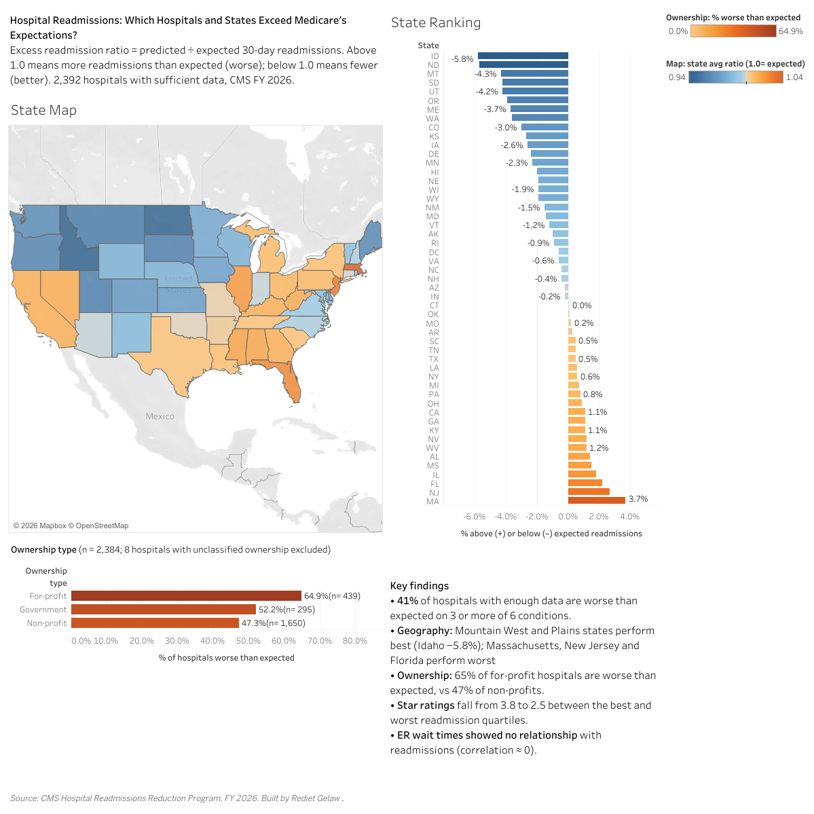

# Hospital Readmissions: Which Hospitals and States Exceed Medicare's Expectations?

An analysis of 30-day hospital readmissions across 2,392 U.S. hospitals using CMS FY 2026 public data, built with **BigQuery SQL** and **Tableau**.

**[View the interactive dashboard on Tableau Public](https://public.tableau.com/app/profile/rediet.gelaw/viz/HospitalReadmissionsCMSFY2026/Dashboard1)**



---

## The question

Medicare's Hospital Readmissions Reduction Program (HRRP) penalizes hospitals whose patients return within 30 days more often than expected. This project asks:

- Which states and hospitals have more readmissions than Medicare expects?
- Does hospital ownership type relate to readmission performance?
- Do CMS star ratings and ER wait times line up with readmission performance?

## Key metric

**Excess readmission ratio** = predicted ÷ expected 30-day readmissions, as published by CMS (already risk-adjusted for patient mix).

- **Above 1.0** → more readmissions than expected (worse)
- **Below 1.0** → fewer readmissions than expected (better)

Each hospital's score is the average of its ratios across the six HRRP conditions: heart attack, heart failure, pneumonia, COPD, hip/knee replacement, and bypass surgery (CABG).

## Data

| Source (CMS Provider Data) | Used for |
|---|---|
| Hospital Readmissions Reduction Program, FY 2026 | Excess readmission ratios by condition |
| Hospital General Information | Ownership type, star rating, location |
| Timely and Effective Care (measure OP_18b) | Median time patients spent in the ER |

**Inclusion rule:** a hospital is included only if it has a ratio for **3 or more of the 6 conditions**, which leaves **2,392 hospitals**. Eight hospitals with unclassified ownership are excluded from the ownership comparison (n = 2,384).

## Key findings

- **41%** of hospitals are worse than expected on 3 or more of 6 conditions.
- **Geography:** Mountain West and Plains states perform best (Idaho −5.8% vs expected); Massachusetts, New Jersey and Florida perform worst.
- **Ownership:** 65% of for-profit hospitals are worse than expected, vs 52% of government and 47% of non-profit hospitals.
- **Star ratings** fall from an average of 3.8 to 2.5 between the best and worst readmission quartiles.
- **ER wait times** showed no relationship with readmissions (correlation ≈ 0).

## Method

1. **Load:** imported raw CMS CSV files into BigQuery.
2. **Clean (SQL views):** converted text fields to numbers and dates with `SAFE_CAST`, replaced CMS measure codes with readable condition names, and standardized hospital names.
3. **Aggregate (SQL):** built hospital-level and state-level summaries using CTEs, window functions (`AVG() OVER (PARTITION BY state)`, `NTILE(4)`, `RANK()`), and `CASE` logic to group 10+ ownership categories into For-profit, Government and Non-profit.
4. **Analyze (SQL):** one query per question, numbered in the order the analysis was built (see the table below).
5. **Visualize (Tableau):** state map, state ranking, ownership comparison and key findings on one dashboard.

## SQL files

| File | What it answers |
|---|---|
| `01_data_profile.sql` | How complete is the data for each condition? |
| `02_cleaning_views.sql` | Cleaning views: text to numbers/dates, readable condition names |
| `02b_check_views.sql` | Sanity check on the cleaned views |
| `03_join_hospital_details.sql` | Worst heart-failure hospitals, and which hospitals are missing details |
| `04_cte_multi_condition_hospitals.sql` | Hospitals worse than expected on 3+ conditions (the **41%** finding) |
| `05_window_rank_states.sql` | Ranking states from best to worst |
| `06_window_partition_worst3_per_state.sql` | The 3 worst hospitals in each state |
| `07_ntile_quartiles.sql` | Performance quartiles and star ratings (the **3.8 → 2.5** finding) |
| `08_ownership_comparison.sql` | For-profit vs non-profit vs government (the **ownership** finding) |
| `09_hospital_vs_state_average.sql` | Each hospital compared with its own state's average |
| `10_er_wait_vs_readmissions.sql` | ER wait times vs readmissions (the **correlation ≈ 0** finding) |
| `exports/export_1_state_summary.sql` | Builds `state_summary.csv` for the map and state ranking |
| `exports/export_2_hospital_summary.sql` | Builds `hospital_summary.csv` for the ownership chart and lookup |
| `exports/export_3_hospital_condition.sql` | Builds `hospital_condition.csv` for condition-level detail |

## Limitations

- **Correlation, not causation.** The ownership gap does not show that ownership causes readmissions; hospital size, location and patient population may explain part of it.
- **Unweighted averages.** Each hospital's score averages its condition ratios equally, without weighting by discharge volume.
- **Single ER measure.** ER wait time uses one CMS measure (OP_18b) and covers only hospitals that report it.
- **Small-hospital exclusion.** Hospitals with fewer than 3 measured conditions are left out, which may under-represent small and rural hospitals.

## Repository structure

```
cms-hospital-readmissions/
├── README.md
├── sql/
│   ├── 01_data_profile.sql ... 10_er_wait_vs_readmissions.sql
│   └── exports/
│       ├── export_1_state_summary.sql
│       ├── export_2_hospital_summary.sql
│       └── export_3_hospital_condition.sql
└── images/
    └── dashboard.png
```

## Tools

Google BigQuery (SQL) · Tableau Public · CMS Provider Data

---

**Rediet Gelaw** · [LinkedIn](https://www.linkedin.com/in/redietgelaw) · [GitHub](https://github.com/redietg0105)
